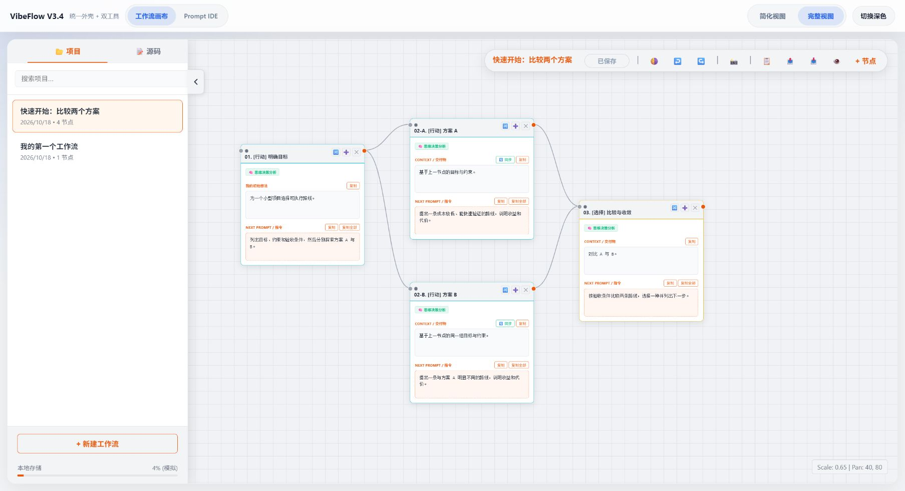

# VibeFlow V3.4

**把工作流画布与 Prompt IDE 放在一起，让复杂的 AI 协作可以被记录、比较和继续推进。**

[在线使用](https://ming2025.github.io/VibeFlow/) · [下载 V3.4.0](https://github.com/ming2025/VibeFlow/releases/tag/v3.4.0) · [使用说明](USER_GUIDE.md) · [数据迁移](MIGRATION.md) · [更新记录](CHANGELOG.md)



## 两个工具，一条工作路径

- **工作流画布**：用节点、分支和连线整理目标、背景、提示词与交付物，支持简化 / 完整视图、导入导出、撤销重做。
- **Prompt IDE**：记录提示词、AI 回复和备注，在独立版本之间比较路线；提供长文本草稿保护、记录 / 阅读模式与内容对比。
- **框架模板**：内置 Reflexion、OPRO、Debate、MCTS、ToT、SoT、Feynman、VDS 和 IREF 系列模板。
- **双工具同步**：AI 回复含有效工作流 JSON 时，可自动导入画布，保留会话、版本与轮次关联。

当前通过人工把提示词发给所选 AI，再把回复粘贴回来。模板与画布同步在工具内执行；**VibeFlow 不自动调用模型，也不是无人值守的 Agent 执行器**。

## 开始使用

1. 打开 [在线版](https://ming2025.github.io/VibeFlow/)，或从 [Release](https://github.com/ming2025/VibeFlow/releases/tag/v3.4.0) 下载 `VibeFlow-3.4.0.html`，用现代浏览器打开。
2. 画布点击“📥”导入 [分支工作流示例](example_workflow.json)，或在 Prompt IDE 导入 [双版本公开记录](example_prompt_ide.json)。
3. 新建会话，用模板库生成提示词；将实际 AI 回复粘贴进回复区并提交保存。
4. 使用 JSON 导出备份。在线版、本地文件、其他浏览器和其他电脑之间需要导出 / 导入，不会随代码发布自动同步。

程序和五个固定版本的依赖均内置在 HTML 中，无需安装软件包或访问 CDN。外部链接、远程图片和你使用的 AI 服务仍可能需要联网。

## 数据与兼容性

记录保存在当前浏览器的 IndexedDB / localStorage，不随仓库上传。建议定期导出 JSON；清除网站数据、使用无痕模式或更换浏览器可能使本地记录不可用。

V3.4 保留 `MergedVibeCodingDB`、`MergedPromptIDE_V6` 等数据名称。旧版迁移使用 JSON。若直接打开文件无法保存，可在所在目录运行 `python -m http.server 8000 --bind 127.0.0.1`，访问 `http://127.0.0.1:8000/`。详见 [MIGRATION.md](MIGRATION.md)。

JSON 是完整备份格式；Markdown 用于阅读和交流。V3.4 画布 Markdown 带连线结构注释，保留注释可往返导入分支；手工改写后的 Markdown 不应替代 JSON 备份。

## 修复与维护

本版修复立即导出取旧数据、快速切换丢编辑、撤销后重做丢节点和 Markdown 分支改线；增加临时恢复记录、事务完成确认、窄屏布局和页面内版本命名。测试方法见 [VALIDATION.md](VALIDATION.md)。

入口仍为单文件 `index.html`。可使用附带脚本解包两个嵌入工具进行维护：

```sh
python release_tools.py unpack index.html editable
python release_tools.py pack editable rebuilt.html
node regression-tests.cjs index.html
```

脚本不覆盖已有目标。测试只使用合成数据与内存存储，不读取个人浏览器记录。后续发布先比较差异、运行检查，再提交和发布版本；没有设置后台自动同步。

## 历史与许可

旧版源码保留在 [333dda9 提交](https://github.com/ming2025/VibeFlow/tree/333dda961e05b8582d816b10da98d2a0ca78a265)，V3.4.0 Release 另附旧版归档。回退代码不等于恢复被修改的数据。

自有代码使用 [MIT](LICENSE)。第三方保留各自许可，见 [来源说明](THIRD_PARTY_NOTICES.md)、[完整许可](THIRD_PARTY_LICENSES.txt) 与 [来源摘要](dependency-manifest.json)。框架模板不表示复现论文算法或取得其研究结果。

欢迎通过 [Issues](https://github.com/ming2025/VibeFlow/issues) 提交版本、复现步骤、预期与实际行为，附可公开的合成示例。
